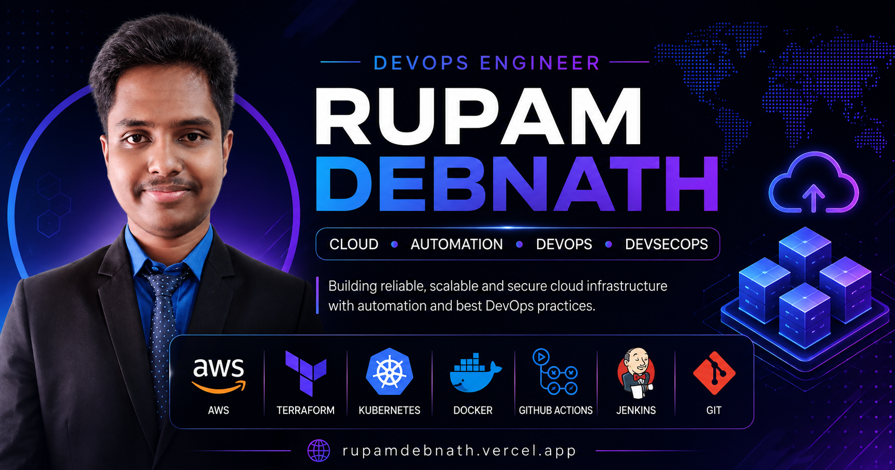

# 🚀 Rupam Debnath | DevOps Portfolio

<p align="center">
  
</p>

<p align="center">


</p>

---

## 🌐 Live Demo

🔗 **Portfolio:** https://your-domain.vercel.app

---

# 📖 About

This is my personal portfolio website built to showcase my experience, projects, certifications, and technical expertise as a **DevOps Engineer**.

The website is designed with a modern UI, smooth animations, responsive layouts, reusable component architecture, and production-ready best practices.

---

# ✨ Features

- 🎨 Modern UI/UX
- 🌙 Dark & Light Theme
- 📱 Fully Responsive Design
- ⚡ Built with React + Vite
- 🎬 Smooth Framer Motion Animations
- 🧩 Component-Based Architecture
- 📂 Featured Projects Section
- 💼 Professional Experience Timeline
- 🏆 Certifications Showcase
- 📬 Contact Section
- 🔍 SEO Optimized
- 🚀 Vercel Ready

---

# 🛠 Tech Stack

### Frontend

- React
- TypeScript
- Vite
- CSS3

### Animation

- Framer Motion

### Icons

- React Icons

### Deployment

- Vercel

---

# 📂 Project Structure

```text
src
│
├── components
│   ├── Navbar
│   ├── Footer
│   └── ThemeToggle
│
├── context
│   └── ThemeContext
│
├── data
│   ├── profile
│   ├── projects
│   ├── experience
│   ├── certifications
│   ├── skills
│   └── social
│
├── features
│   ├── hero
│   ├── about
│   ├── skills
│   ├── projects
│   ├── experience
│   ├── certifications
│   └── contact
│
├── styles
│   ├── globals
│   ├── variables
│   ├── utilities
│   ├── hero
│   ├── about
│   ├── skills
│   ├── projects
│   ├── experience
│   ├── certifications
│   ├── contact
│   └── footer
│
├── App.tsx
└── main.tsx